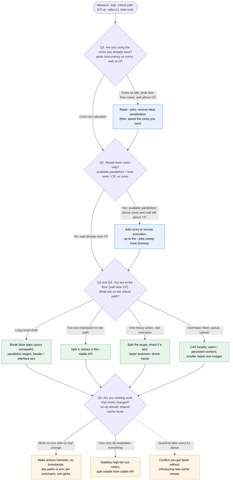
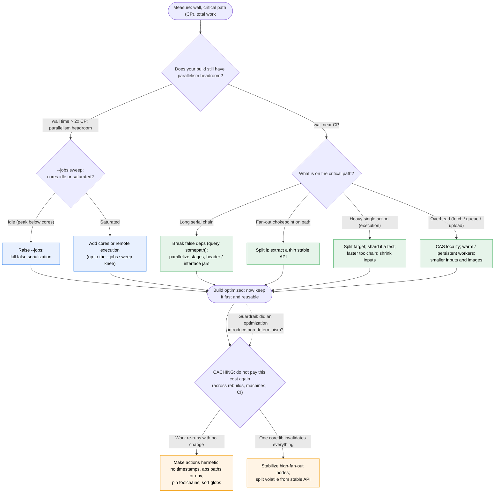

# Build Optimization Decision Tree

How fast *can* and *should* your build be? Measure three numbers, work out how far
you are from optimal, then follow the tree. Optimize the build itself first (use the
cores you have, then lower the critical path). Caching comes last: once the build is
fast, make sure you do not pay the cost again, and that an optimization did not quietly
break reproducibility.

Two versions below. **Option A** is the canonical, slide-aligned procedure: every node
is a question, every branch is an answer, every answer points to a path. It is the one
to print and the one an agent follows. **Option B** is the same logic framed around the
"floor and levers" mental model, for the slide where we want a picture, not a checklist.

---

## The three numbers (measure first)

- **Wall time**: elapsed build time, the number you feel.
- **Critical path (CP)**: the longest chain of dependent actions. Measure at `--jobs=1`
  so contention does not inflate it. This is the **floor** of the current graph: no
  number of cores beats it.
- **Total work**: the sum of every action's duration, roughly the `--jobs=1` wall.

---

## How far from optimal (the math behind every branch)

From those three numbers, four derived quantities tell you where you stand. An agent
computes all four and reports them before proposing anything.

| Quantity | Formula | Reads as |
|---|---|---|
| Observed parallelism | total work / wall | "You are effectively using N cores." |
| Headroom factor | wall / CP | "You are this many times above your current floor." |
| Available parallelism | total work / CP | "Cores beyond roughly this count stop helping." |
| Current floor | CP | "Best wall reachable by scheduling alone, no code change." |

Two optimums, not one:

1. **Reachable now (money / parallelism):** with enough cores and no false
   serialization, wall approaches **CP**. The gap you can still close is `wall / CP`.
2. **Reachable with engineering (lower the floor):** CP itself drops once you shorten
   or split the actions sitting on it. This is the real "how fast it *can* be," and it
   is below today's CP.

The headroom factor is a quick estimate; the **`--jobs` sweep** (run `1, 2, 4, 8, ...`
and plot wall) is the proof. Where the curve flattens is the knee: that is how many
cores actually help, and if wall stops falling well above CP you have false
serialization, not a core shortage.

---

## Option A: the canonical, slide-aligned tree

Each decision node is the question shown on its slide. Follow it top to bottom.

Color key: **blue = parallelism (money, "how fast it should be"), green = lower the
floor (engineering, "how fast it can be"), orange = caching (the epilogue).**

### The five questions, as slides

| # | Question on the slide | If the answer is... | Path |
|---|---|---|---|
| Q1 | Are you using the cores you already have? | cores idle | raise `--jobs`, kill false serialization (free) |
| Q2 | Would more cores help? | available parallelism > cores | add cores / remote execution (money) |
| Q3+Q4 | What sits on the critical path? | chain / chokepoint / heavy action / overhead | the matching engineering move |
| Q5 | Are you redoing work that never changed? | re-runs with no change | hermeticity, stabilize high-fan-out |
| all | After each fix, did a no-op rebuild stay clean? | new cache misses | undo the non-determinism you introduced |

---

## Option B: the floor-and-levers framing (creative)

Same logic, told as a picture: there is a floor (CP), you close the gap to it with
money, you lower it with engineering, and caching keeps you from paying twice.

---

## Operationalizing for an agent

The decision tree is a procedure, so an agent can run it. Given a (clean) build, the
agent gathers the inputs, computes the four quantities, states how far the build is
from optimal, and ranks proposals.

**Gather:**
- wall (normal build), CP (`--profile` critical path, confirmed at `--jobs=1`),
  total work (sum of action durations, or the `--jobs=1` wall), core count.
- a `--jobs` sweep (`1, 2, 4, 8, ...`) to locate the knee.
- top on-CP actions (slowest actions that also sit on the critical path), each tagged
  execution vs overhead.
- a no-op rebuild to check cache reuse.

**Compute and state the gap:**
- "Observed parallelism is total work / wall = N cores in use."
- "Headroom factor is wall / CP = X. You are X times above your current floor."
- "Available parallelism is total work / CP = P. Cores beyond about P stop helping;
  the sweep knee confirms it at K cores."
- "Current floor is CP. With cores up to the knee and no false serialization, wall
  reaches about CP: a reachable-now speedup of X times."
- "The top on-CP actions account for Y of CP. Splitting / shortening them lowers the
  floor to about CP minus Y: that is how fast it can be."

**Propose, ranked by cost then impact:**
1. Parallelism (cheap or free): raise `--jobs`, remove false serialization; then add
   cores up to the knee.
2. Lower the floor (engineering): the matching move for each top on-CP action.
3. Caching (epilogue + guardrail): fix any non-determinism found in the no-op rebuild,
   stabilize high-fan-out nodes, and re-verify after every change above.

The output format matches the slides: for each proposal, show the result/status it
addresses, the money column, and the engineering column.

---

## Inner loop vs outer loop (framing, not a branch)

Same tree either way; the loop sets which metric you chase.

- **Inner loop:** a developer's local edit, build, test cycle. Optimize **latency**.
- **Outer loop:** CI and shared builds, often with a high remote-cache hit rate.
  Optimize **throughput and cost**; the caching epilogue matters most here, because a
  warm shared cache is what makes CI pay only for what changed.

A cold build (empty cache) is the rarer third case where the floor and parallelism
analysis dominates everything.
